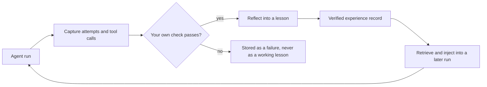
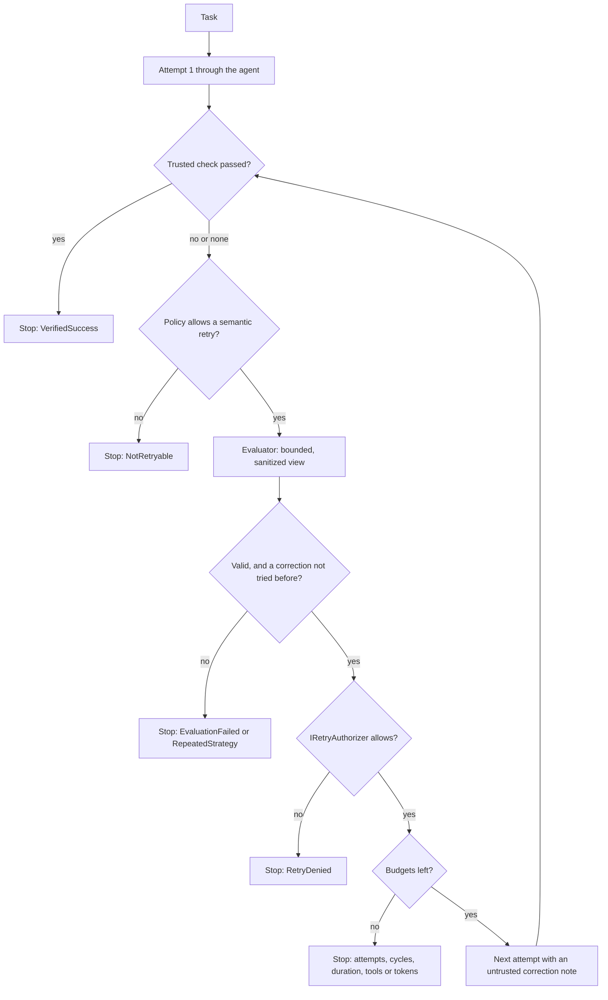
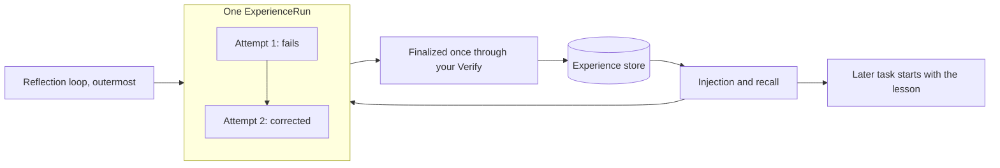
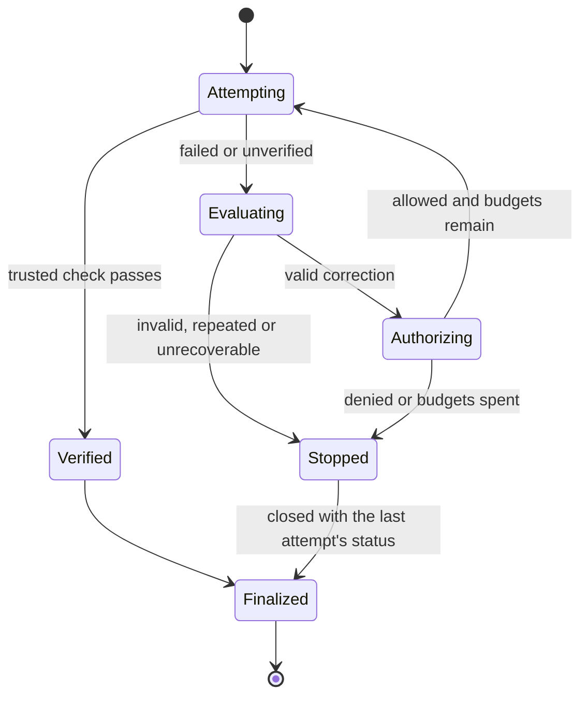

# Reflective execution (experimental)

Reflective execution lets an agent **evaluate an attempt, propose a corrected strategy and try again** inside one task,
within hard budgets and only with your authorization. It is experimental: the API may change in a later preview, and
nothing here claims it improves results. Whether it helps your tasks is what the [holdout](injection.md#measuring-benefit-the-holdout)
and your own measurements are for.

It is **off by default**. With `Enabled = false` the wrapped agent behaves exactly as without it.

## Two things that are not the same

| | What it does | Where |
| --- | --- | --- |
| Experience reflection | Turns a finished, **verified** run into a durable lesson for later runs | [Finalization](finalization.md), existing |
| Execution reflection | Evaluates the current attempt and retries it with a correction | this page |

They connect only through the existing pipeline. A model's opinion that an attempt worked is **advisory**: it can steer a
retry, and it is never verification evidence. Only your own check ends a loop as verified, and only your `Verify` makes a
stored record verified.

## Diagrams

**1. The existing experience loop (unchanged).**



**2. The reflective loop (new, around the agent).**



**3. Reflection and experience memory together.** One run, many attempts, one record.



**4. Failure and retry lifecycle.**



## Quick start

```csharp
services.AddAgentExperience(options => { /* identity, Verify, storage as today */ })
        .UseInMemoryStorageForDevelopment();

services.AddReflectiveExecution(options =>
{
    options.Limits = new ReflectionExecutionOptions
    {
        Enabled = true,
        MaxAttempts = 3,
        SideEffects = SideEffectPolicy.Idempotent,   // see "Side effects" below
    };
    options.Evaluator = new DeterministicReflectionEvaluator([...rules...]);   // or ChatClientReflectionEvaluator
    options.Authorizer = new MyRetryPolicy();                                  // the default denies
    options.TrustedCheck = (view, ct) => ValueTask.FromResult<bool?>(BuildIsGreen());
});

var agent = new ChatClientAgent(client, agentOptions).AsBuilder()
    .UseReflectiveExecution(provider)   // FIRST: it must be the outermost layer
    .UseAgentExperience(provider)
    .Build();
```

Run the [sample](../../samples/AgentExperience.Sample.Reflective/README.md) to see both a corrected run and a run that
starts from the stored lesson.

## How the loop works

1. Run attempt 1 through the agent. Nothing else runs if your `TrustedCheck` passes: **no model is called when reflection
   adds no value.**
2. Otherwise, if the task's `SideEffects` policy allows a semantic retry and an evaluator is set, the evaluator gets a
   bounded, sanitized view: error classes, failed tool names, a short result excerpt, the strategies already tried. Never
   raw tool arguments or results.
3. The evaluation is validated (below). A valid `NeedsCorrection` with a proposed strategy goes to your
   `IRetryAuthorizer`. Only if it says yes does attempt 2 run, with the original task plus one labelled, bounded note.
4. Repeat until a stop reason. The run is then closed with the last attempt's status and finalized **once**, through your
   `Verify`, exactly as a run you completed yourself.

All attempts are attempts of **one** `ExperienceRun` (`ContinuesRunId` under the hood), so the failure and the fix are one
lesson, and reflection steps never create extra records. The injection holdout is decided per run ID, so one task never
mixes arms.

## Middleware order

`UseReflectiveExecution` wraps the agent from outside because a retry means invoking the agent again, which no inner
middleware can do, and capture must see every attempt as its own invocation. Call it **first** on the builder, before
`UseAgentExperience`. Streaming (`RunStreamingAsync`) is not retried and passes straight through.

## Choosing an evaluator

| Strategy | Triggered by | Model? |
| --- | --- | --- |
| `DeterministicReflectionEvaluator` (failure-driven) | Your rules over the failed calls and error classes | No |
| `RequirementReflectionEvaluator` (requirement-driven) | A task requirement the finished output does not meet | No |
| `ChatClientReflectionEvaluator` (model-assisted) | An `IChatClient` reads the sanitized facts and proposes one correction | Yes |
| `CompositeReflectionEvaluator` | Several of the above: `Unrecoverable` from any wins, else the first correction, issues merged | Whichever it holds |
| Your own `IReflectionEvaluator` | Anything | Your choice |

`IReplanningStrategy` (`options.Replanning`) turns an evaluation into the correction text. The default uses the
evaluator's proposal; a host replaces it to keep corrections inside its own rules (a catalogue, a template). It returns
text only, which is bounded and screened, so it cannot change the task or the permissions.

## Stop reasons

`VerifiedSuccess` (your check passed), `EvaluatorSatisfied` (no check exists and the evaluator found nothing; **not**
verified), `CyclesExhausted`, `AttemptsExhausted`, `DurationExhausted`, `BudgetExhausted` (tool calls or tokens),
`RetryDenied`, `NotRetryable`, `RepeatedStrategy`, `EvaluationFailed`, `Unrecoverable`, `Disabled`. Your caller's
cancellation propagates as `OperationCanceledException`.

An evaluator saying "fine" against a failing trusted check ends as `NotRetryable`, never as success.

## Configuration

| Option | Default | Meaning |
| --- | --- | --- |
| `Enabled` | `false` | Nothing retries until set |
| `MaxReflectionCycles` | 2 | Corrections after the first attempt |
| `MaxAttempts` | 3 | Attempts in total; must not exceed capture's `MaxAttemptsPerOpenRun` (8) |
| `MaxDuration` | 5 min | Whole execution; must not exceed capture's `MaxOpenRunDuration` |
| `MaxToolCalls`, `MaxTokens` | none | Tool calls come from capture; tokens from the response's usage when the provider reports it |
| `EvaluationTimeout` | 30 s | One evaluator or authorizer call |
| `SideEffects` | `NeverRetry` | See below |
| `MaxCorrectionLength` | 1,000 | The note handed to a retry |
| `Evaluator` | none | No evaluator means only transient technical retries |
| `Authorizer` | deny all | Called before every retry |
| `TrustedCheck` | none | Your check, after each attempt: `true` passed, `false` failed, `null` no verdict |
| `OnEvent` | none | One event per execution: counts and enums, no prompt, argument or model text |
| `Replanning` | evaluator's proposal | Builds the correction text from an evaluation |

A bound that capture would enforce first (attempts, duration) is refused when the agent is built, with a message naming it.

## Side effects

`SideEffectPolicy.NeverRetry` (default) never retries semantically, so enabling the loop on an agent that sends email or
moves money does nothing surprising. `RequiresAuthorization` and `Idempotent` both still pass through the authorizer and
every budget. Marking a task `Idempotent` is your statement that repeating it is safe; the library cannot know.

A transient technical failure (`TimeoutException`, `HttpRequestException`) is retried without the evaluator and without a
note, under the same policy and authorizer.

## What the evaluation is allowed to be

Evaluator output is untrusted and validated before use: at most 8 issues, each text at most 500 characters, a defined
category and assessment, a finite confidence in [0, 1], a strategy within `MaxCorrectionLength`, and every text checked
by the same content guard model-authored lessons pass (credential shapes, instruction-override phrasing, links the attempt
did not show). An invalid evaluation stops the loop as `EvaluationFailed`; it is never retried blindly. The confidence
is the evaluator's own advisory number and is unrelated to the verified reuse confidence stored on records.
`ChatClientReflectionEvaluator` parses strictly (unknown properties are refused) and is told never to ask for tools,
permissions or links.

## Security boundaries

The loop cannot change identity or scope, add tools, approve a tool, run a command, skip your verification or write a
record. It calls the same agent, with the same tools, and the identity capture resolves for each attempt. The note it adds
is labelled untrusted reference text in a user message, not a system or developer instruction, which is a trade-off
documented in the [limits](#limits). Recall at the moment of failure keeps working inside every attempt; reflection adds no
competing recovery path.

## Telemetry

Four counters on the meter `AgentExperience.MicrosoftAgentFramework.ReflectiveExecution`, one tag, enums only:

| Counter | Counts | Evidence? |
| --- | --- | --- |
| `agentexperience.reflection.executions` (tag `agentexperience.reflection.stop_reason`) | executions, by why they stopped | n/a |
| `agentexperience.reflection.retries` | executions in which a retry occurred | no |
| `agentexperience.reflection.retries.improved` | executions in which a retry did better than the attempt before | no |
| `agentexperience.reflection.retries.verified` | executions in which a retry ended with your own check passing | **the only one** |

No prompt, tool argument, error text, model text or identity is ever a tag. `OnEvent` carries the same facts with the run ID.
The meter is deliberately not in `docs/telemetry-names.json`: the Python and Go ports have no reflective execution, so no
port has to match these names.

## Public API compatibility

Purely additive: new types in `AgentExperience.Core.ReflectiveExecution` and `AgentExperience.MicrosoftAgentFramework.ReflectiveExecution`,
two extension methods (`AddReflectiveExecution`, `UseReflectiveExecution`), and no change to an existing signature, option,
default, stored format or migration. The public API baselines grew and lost nothing. Everything here is **experimental** and may
change in a later preview. With reflective execution unregistered or disabled, behavior is what it was.

## Limits

- **The correction note is model-derived text in the conversation.** It is screened and bounded, but, like any
  model-authored lesson, a screen is not a boundary ([KL-18](../known-limits.md)). The approval boundary around tools is the
  control that matters.
- **The retry sees the first attempt's messages.** All attempts share one session so the model can see what failed. A host
  that wants a clean session per attempt should not use the wrapper.
- **Your `TrustedCheck` is your statement.** It is a retry signal, not finalization. A check that disagrees with `Verify`
  gives a loop that stops "verified" on a record that is then stored as failed.
- **Tokens are counted only when the provider reports usage.** A provider that does not makes `MaxTokens` inert.
- **The meter is separate and experimental.** See [Telemetry](#telemetry); its names are not in the cross-language names file.
- **Only `RunAsync`.** Streaming is not retried.
- **No benefit is demonstrated.** The sample's four-arm comparison uses a scripted model that obeys what it is handed. It
  proves the mechanics, not an improvement.
- **Python, Go, the CLI and the MCP server are unchanged.**

See also the [design assessment](../architecture/reflective-execution-design.md).
